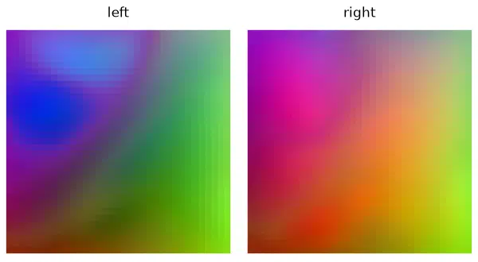
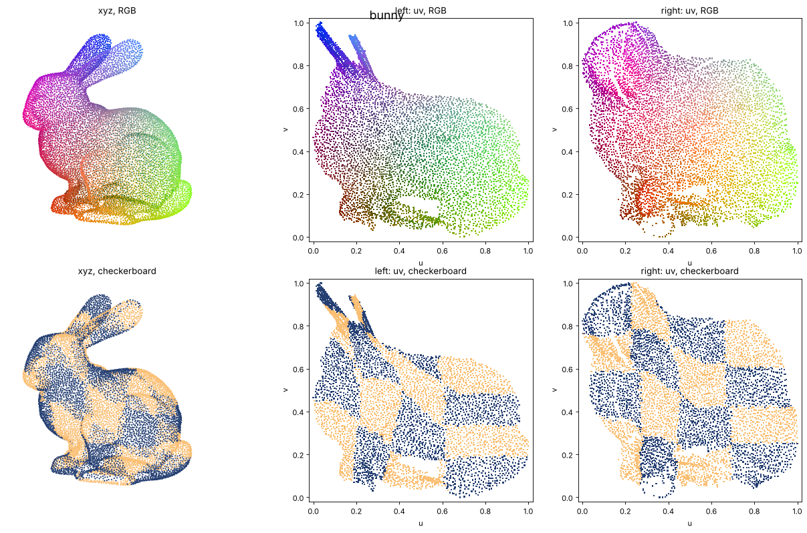
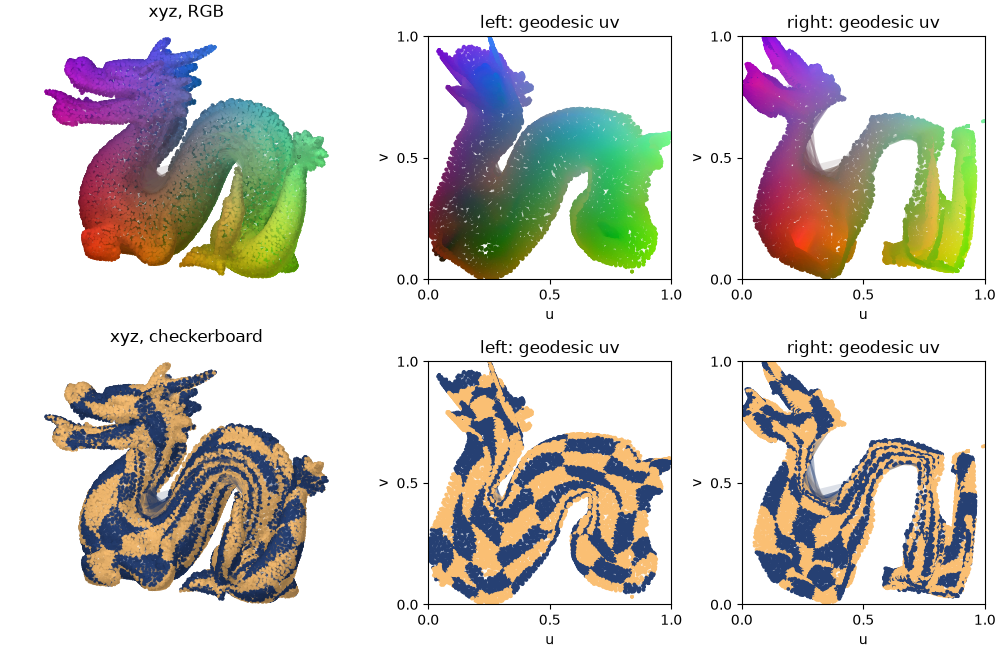

# flatpoints

Turn a 3D point cloud sampled on a latent (unknown) surface into something flat:



flatpoints take raw point clouds and compute two kinds of flattening: 
- **UV**: 2D coordinates of the points, xyz -> uv: `uv_geodesic_shortcut` (close to the
  distances, keeps the shape recognisable) or `uv_conformal` (angle preserving, no overlap).
- **Images**: a square `(n, n)` pixel structure for multi indexing, idx -> (row, column).
  Each pixel holds one point of the cloud, neighbour pixels hold neighbour points.

You can then use 2D tools on the point cloud: convolutions, SVD, image codecs…
How it works: see [Method.md](Method.md).

Note: During the flatpoints process, a mesh of the point cloud is generated using Open3D. \
The mesh itself can be useful, so it is also exposed.




## Install

```bash
pip install -e ".[viz]"   # numpy, scipy, gridpoints, open3d (+ matplotlib)
```

## Quickstart

Take a raw 3D point cloud `(N, 3)` and flatten it to 2D.
Available models: bunny, dragon, airplane, cow, everest…

```bash
python exemple_flat.py --bunny
```

## Usage


```python
import numpy as np
import src.flatpoints as fp

xyz = np.load("data/bunny_points.npy") #raw (N, 3) points, on a latent (unknown) surface
z = xyz[:, -1] #(N, *C) any data related to the point cloud, e.g. the z coordinate

# ==== Build the flat object ============

flat = fp.Flat(xyz) # Apply the flattening processing of the surface

# ==== Use it  ==========================

#I. Pixels and Images (learned multi index of the points: idx -> row, column)
i = 42 #point with index 42
face, row, col = flat.pixels[i] # face = 0 or 1 for left and right hemispheres (see the Cut section)
image = flat.to_image(z)    # full pixel image,  (N, *C) to  (1, n, n, *C) or (2, n, n, *C) 
fig = flat.imshow(z)        # plot the image 
anim = flat.imshow(z, animate="z.webp") # animated webp: the images fold into the surface in 3D

#II. UV (2D embeding of the points on the surface, xyz -> uv):
uv = flat.uv_geodesic_shortcut #(N, 2) better visual aspects
uv = flat.uv_conformal         #(N, 2) angle preserving, no overlaps
fig = flat.plot()                    # 3D and uv_geodesic_shortcut
fig = flat.plot(uv="conformal")      # 3D and uv_conformal

# ==== Reuse the internal mesh (generated with open 3D):

V, T = flat.mesh.vertices, flat.mesh.triangles # (V, 3), (T, 3)
face = flat.mesh.face                          # (T,) face of each triangle: 0, 1, or -1 (in no face)
chart = flat.charts[0]                         # left face: vertices (indices in V), triangles, uv_conformal
```

### Cut

To map the surface properly to a square, flatpoints need to cut it first in two hemispheres \
if needed. The hemispheric cut will remove some (not all) topological closedness. Residual  \
closedness (e.g. for a torus, which cannot be opened by a single cut) will also be automatically \
cut by shearing the surface further on each hemisphere.

- Use `fp.Flat(points, single_face=True)` for an open surface (e.g. a terrain), \
to flatten it on a single map.
- Use `fp.Flat(points, single_face=False)` for a closed surface (e.g. a dragon), \
to flatten left and right hemispheres independently. 

`normal_axis` (fp.Flat(points, single_face=..., normal_axis = "x")) is the axis the \
surface is seen along: `single_face = False` (two hemispheres) will cut roughly across it, and \
`single_face = True` (open surface) will use it as an heuristic to project the data.The normal \
axis used has a strong impact on the accuracy of the Flat, be sure to use a normal axis consistant \
with your point cloud (eg it can be the third axis after applying a PCA).

See [exemple_flat.py](exemple_flat.py).

## Application: resampling a point cloud

```bash
python exemple_sampler.py --bunny       # plots_resampling/bunny_resampled.png
```

Sampling from a mesh is easy: sample uniformly on each triangle. Resampling from a point
cloud is harder, because there is no surface to sample from, only points.

`Flat` provides that missing surface: through `to_image`, it maps the unit square onto the
cloud. So one can sample points in the unit square and transport them onto the surface by
bilinear interpolation, (row, col) → xyz.

By default, `flat.resample` uses a hyperuniform 2D seed (blue noise), so the new points are
fairly evenly spread over the surface.

```python
sampler = flat.resample(n_points=512)   # n new points in total
new = sampler.points                    # (512, 3)
sampler.plot()                          # before / after
other = flat.resample(n_points=512, seed=1)  # a new resampling, with different seed
```
**To be honest:** if you only need a subset of the input points, farthest point sampling
(FPS) are more uniform than flatpoints (figure bellow), this is mainly an exemple usecase to show how to use the Flat to transport properties (like good spatial repartition) from the simple unit square to an arbitrary surface.


## Licence

- code: MIT, except `src/flatpoints/rcm.py`.
- `src/flatpoints/rcm.py`: Python port (modified) of
  [garyptchoi/rectangular-conformal-map](https://github.com/garyptchoi/rectangular-conformal-map),
  Copyright (c) 2015-2024 Gary Pui-Tung Choi, Apache License 2.0, see
  [LICENSE-rectangular-conformal-map](LICENSE-rectangular-conformal-map).
- data: see [data/README.md](data/README.md).

## Acknowledgement

The conformal uv and the images rely on the rectangular conformal map of:

```bibtex
@article{meng2016tempo,
  title   = {{TEMPO}: Feature-Endowed {T}eichm{\"u}ller Extremal Mappings of Point Clouds},
  author  = {Meng, Ting Wei and Choi, Gary Pui-Tung and Lui, Lok Ming},
  journal = {SIAM Journal on Imaging Sciences},
  volume  = {9},
  number  = {4},
  pages   = {1922--1962},
  year    = {2016},
  doi     = {10.1137/15M1049117}
}
```
