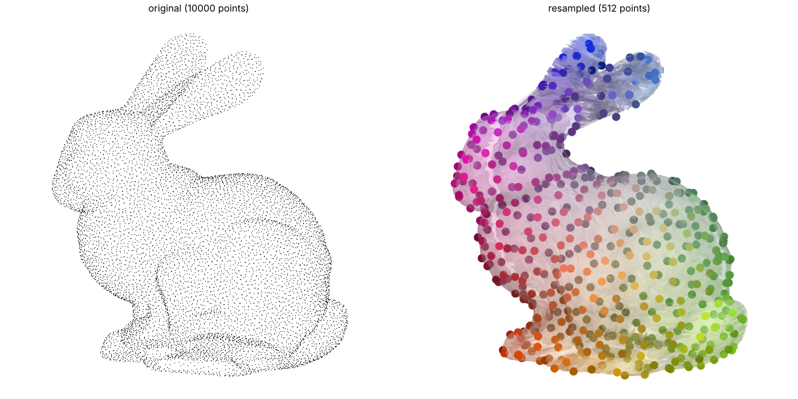

# flatpoints

Turn a 3D point cloud sampled on a surface into something flat:
- Isomaps: smooth parametrisation of the surface, xyz -> uv 
- Images: a square `(n, n)` pixel structure for multi indexing,  idx -> (row, column). \
    Each pixel holds one point of the cloud, neighbor pixels hold neighbor points.

You can then use 2D tools on the point cloud: convolutions, SVD, image codecs…


## Install

```bash
pip install -e ".[viz]"
```

## Quickstart

Take a raw 3D point cloud (N, 3), and flatten it to 2D. \
Available: bunny, dragon, airplane, cow, everest...

```bash
python exemple_flat.py --bunny
```

## Usage

```python
xyz = np.load("data/bunny_points.npy") #raw (N, 3) point cloud
data = xyz #(N, *C) data related to the point cloud, e.g. the points themselves

# ==== Build the flat object ============

flat = Flat(xyz) # Apply the flattening processing of the surface

# ==== Use it  ==========================

#I. Isomaps (projection of the points, latent 2D coordinates on the surface xyz -> uv):
uv = flat.uv #(N, 2)

#II. Pixels (learned multi index of the points: idx -> row, column)
i = 42 #point with index 42
face, row, col = flat.pixels[i] # face = 0 or 1 for left and right hemispheres (see topology section)

#III. Images (convert any data to an image using the pixel layout):
image = flat.to_image(data)    # (N, *C) to  (2, n, n, *C)
```

### Topology

Use `fp.Flat(points, single_face=True)` for an open surface (e.g. a terrain), \
to flatten it on a single map.

Use `fp.Flat(points, single_face=False)` for a closed surface (e.g. a dragon), \
to flatten left and right hemispheres independantly

See [exemple_flat.py](exemple_flat.py).

## An application exemple: Resampling from a point cloud

While sampling from a mesh is relatively easy (by sampling uniformly on each of its
triangles), it is difficult to resample from a point cloud: the usual subsampling methods 
(voxel grids, farthest point sampling) can only pick points of the input cloud. 
Flatpoints provides the missing parametrisation which allow to work on the latent surface directly:
Because it maps the 2D unit square to the point cloud surface through the `to_image` paradygm, one
just needs to sample points on the 2D unit square and then transport them to the surface
by bilinear interpolation, (row, col) -> xyz.
By default, the 2D points are a window of a hyperuniform seed (blue noise), so the new points are evenly spread
over the surface.

```python
sampler = Resampler(xyz, n=256)  # n new points per face (calls Flat(xyz))
new = sampler.points             # (2 * 256, 3) the new points
flat = sampler.flat              # the Flat of xyz
sampler.plot()                   # new points on the mesh of the full cloud

other = Resampler(xyz, n=256, seed=1)  # a new resampling, independent from the previous one
```

See [exemple_sampler.py](exemple_sampler.py).

```bash
python exemple_sampler.py --bunny # plots/bunny_resampled.png 
python exemple_sampler.py --all   # plots/resampled.png 
```



## Licence

- code: MIT
- data: see [data/README.md](data/README.md).
