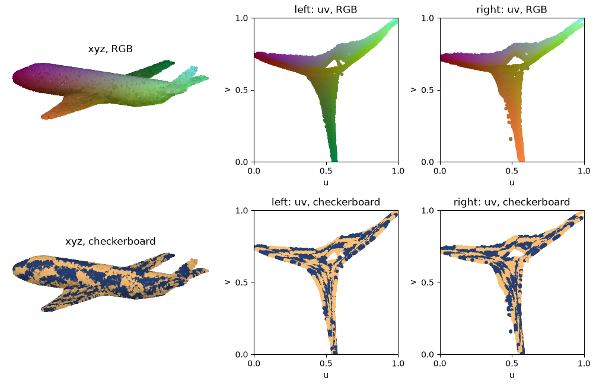

# flatpoints

Turn a point cloud sampled on a surface into square `(n, n)` images, where neighbouring
pixels hold points that are close **on the surface**. You can then use 2D tools on it:
convolutions, SVD, image codecs…





## Install

```bash
pip install -e ".[viz]"
```

## Usage

```python
import numpy as np
import flatpoints as fp

points = np.load("data/bunny_points.npy")   # (N, 3)
flat = fp.Flat(points)                      # faces "left" and "right"
fp.plot(flat)  #show flattening

idx = flat.indexes["left"]   # (n, n)     index of each pixel's point
uv  = flat.isomap["left"]    # (n, n, 2)  flat coordinates (u, v) in [0, 1]
xyz = points[idx]            # (n, n, 3)  the cloud as an image
fp.imshow(xyz) #rgb chanels
```

Use `fp.Flat(points, single_face=True)` for an open surface.
See [exemple.py](exemple.py).

## Data

`data/` holds clouds sampled from classic 3D test models. They are **not** covered by the
code's license: see [data/README.md](data/README.md).
