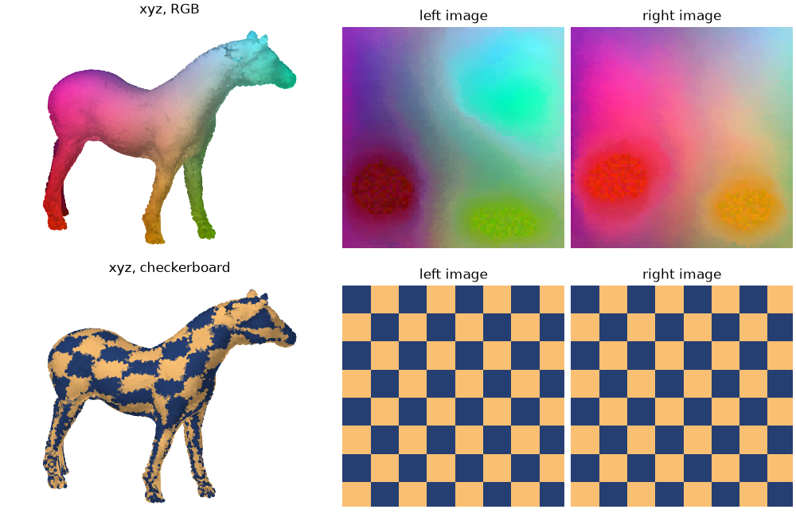

# flatpoints

Turn a point cloud sampled on a surface into square `(n, n)` images, where neighbouring
pixels hold points that are close **on the surface**. You can then use 2D tools on it:
convolutions, SVD, image codecs…

Each pixel holds exactly one point. The only exception is a few pixels in the corners,
which repeat a point as padding, since the grid needs exactly `n²` points.

flatpoints gives you two mappings:

- **isomap**: latent coordinates `(u, v)` of each point, i.e. a smooth
  `(x, y, z) → (u, v)` parametrisation of the surface.
- **indexes**: pixelisation of the (u,v) isomap to fill a square image. Each cell `[i, j]` of the image 
  holds the index of a point in the cloud.



## Install

```bash
pip install -e ".[viz]"    # numpy, scipy, gridpoints (+ matplotlib for plots)
```

## Usage

```python
import numpy as np
import flatpoints as fp

points = np.load("data/bunny_points.npy")   # (N, 3)
out = fp.flatten(points)

idx = out["indexes"]["left"]   # (n, n)     index in `points` of each cell's point
uv  = out["isomap"]["left"]    # (n, n, 2)  flat coordinates (u, v) in [0, 1]
xyz = points[idx]              # (n, n, 3)  the cloud as an image

fp.plot(out, points)     # 3D view + (u, v) of each face
fp.imshow(out, points)   # the grids as images
```

## How it works

0. **Split** the cloud into two equal hemispheres, at the median of the `lateral` axis.
Spliting is optional, only for closed topologies, and result in a left and right face. 
1. **Geodesics** on the neighborgraph of each hemisphere: each point is linked to its 48 nearest cells, then compute minimal
paths on the graph to reference landmarks
3. **Isomap** we triangulate the geodesics distances to the landmarks to get `(u, v)` isomap.
4. **Pixels** each point is assigned an [i, j] pixel of an image by sorting the `(u, v)` isomaps. 


## Data

`data/` contains point clouds sampled from classic 3D test models (bunny, dragons, armadillo,
airplane, horse, cow, Spot, Max Planck). They are **not** covered by the code's license: see
[data/README.md](data/README.md) for sources and terms of use.