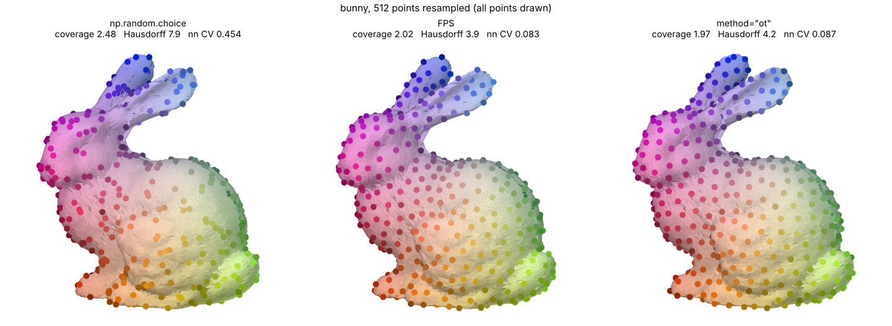
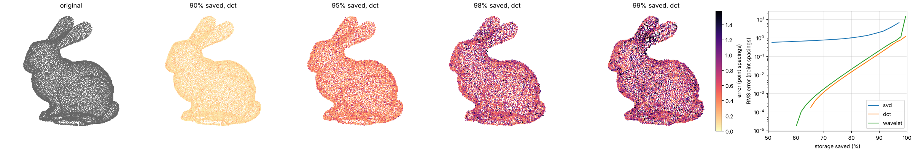

# flatpoints

[](https://pypi.org/project/flatpoints/)
[](https://github.com/neighborhood-grid/flatpoints)

Turn a 3D point cloud sampled on a latent (unknown) surface into something flat.

<table>
  <tr>
    <th>INPUT: raw point cloud</th>
    <th>OUTPUT: flat transformation</th>
  </tr>
  <tr>
    <td></td>
    <td></td>
  </tr>
</table>

[▶️ bunny 🐇 ](https://raw.githubusercontent.com/neighborhood-grid/flatpoints/main/plots/animation/bunny.webp) \
[▶️ dragon🐉 ](https://raw.githubusercontent.com/neighborhood-grid/flatpoints/main/plots/animation/dragon.webp) \
[▶️ elephant 🐘 ](https://raw.githubusercontent.com/neighborhood-grid/flatpoints/main/plots/animation/elephant.webp) 

flatpoints takes a raw point cloud `(N, 3)` and arranges its points on a square `(n, n)`
grid of pixels:

- **one pixel per point**: each point gets its own pixel, idx -> (row, column)
- **neighbour pixels hold neighbour points**: two adjacent pixels hold two points close
  on the surface, so the image is a continuous picture of the surface.

Any data attached to the points, `(N, *C)`, then becomes an image `(n, n, *C)`: the xyz
coordinates, normals, colours, features... and the whole 2D toolbox applies to the point
cloud: convolutions and CNNs, SVD, grid interpolation…

This is the idea of the *geometry images* of [Gu, Gortler & Hoppe (2002)](https://hhoppe.com/proj/gim/),
which remesh a surface onto a completely regular grid. flatpoints applies it directly to a point cloud. 
How it works: see [Method.md](https://github.com/neighborhood-grid/flatpoints/blob/main/Method.md).

## Install

```bash
pip install flatpoints                # core: numpy, scipy, gridpoints, open3d
pip install "flatpoints[viz]"         # + matplotlib, Pillow (plots, animations)
pip install "flatpoints[compress]"    # + PyWavelets, Pillow (compression)
#or pip install "flatpoints[all]"     # (everything)
```

## Quickstart

Take a raw 3D point cloud `(N, 3)` and turn it into images.
Available models: bunny, dragon, elephant, airplane, cow, everest… (`fp.datasets()`)

```python
import flatpoints as fp
fp.exemple_flat("bunny")   # prints the shapes, plots the surface and its images
fp.exemple_flat("bunny", save="plots", animate=True)  # + saves plots/bunny.png and plots/animation/bunny.webp
```

## Usage

```python
import numpy as np
import flatpoints as fp

xyz = fp.load("bunny") #raw (N, 3) points, on a latent (unknown) surface
z = xyz[:, -1] #(N, *C) any data related to the point cloud, e.g. the z coordinate

# ==== Build the flat object ============

flat = fp.Flat(xyz) # Apply the flattening processing of the surface

# ==== Use it: pixels and images ========

i = 42 #point with index 42 (xyz[42])
face, row, col = flat.pixels[i] # face: 0 or 1 (see the Cut section)
image_z = flat.to_image(z)    # full pixel image,  (N, *C) to  (1, n, n, *C) or (2, n, n, *C)
fig = flat.plot()           # the surface in 3D and its images 
fig = flat.imshow(z)        # plot any data on the images
anim = flat.imshow(z, animate="z.webp") # animated version
```

### Cut

To map the surface properly to a square, flatpoints need to cut it first in two hemispheres \
if needed. The hemispheric cut will remove some (not all) topological closedness. Residual  \
closedness (e.g. for a torus, which cannot be opened by a single cut) will also be automatically \
cut by shearing the surface further on each hemisphere.

- Use `fp.Flat(points, single_face=True)` for an open surface (e.g. a terrain), \
to flatten it on a single image.
- Use `fp.Flat(points, single_face=False)` for a closed surface (e.g. a dragon), \
to flatten left and right hemispheres independently, on two images.

Cutting relies on the `normal_axis` (`"x"` by default, `"y"` or `"z"`) to define the
left and right hemispheres of the surface. A different `normal_axis` will result in a
different flattening, but any cutting direction should work. With `single_face=True`,
there is no cut and `normal_axis` only orients the image (which way is up, where the
corners go).

See `fp.exemple_flat` ([examples.py](https://github.com/neighborhood-grid/flatpoints/blob/main/src/flatpoints/examples.py)).

## Application: resampling a point cloud

```python
fp.exemple_sampler("bunny", save="plots")      # plots/resampling/bunny_resampled.png
```

Sampling from a mesh is easy: sample uniformly on each triangle. Resampling from a point
cloud is harder, because there is no surface to sample from, only points.

The images provide that missing surface: `to_image(xyz)` maps the 3D cloud onto the unit 2D square. 
So one can sample points in the square and transport them onto the surface by
bilinear interpolation of the xyz image, (row, col) → xyz.

By default, `flat.resample` uses a hyperuniform 2D seed (blue noise), so the new points are
fairly evenly spread over the surface.

```python
sampler = flat.resample(n_points=512)   # n new points in total
new = sampler.points                    # (512, 3)
sampler.plot()                          # before / after
other = flat.resample(n_points=512, seed=1)  # a new resampling, with different seed
```
**To be honest:** if you only need a subset of the input points, farthest point sampling
(FPS) are more uniform than flatpoints (figure below), this is mainly an exemple usecase to show how to use the images to transport properties (like good spatial repartition) from the simple unit square to an arbitrary surface.




## Application: compressing a point cloud

needs PyWavelets and Pillow (`pip install "flatpoints[compress]"`)

```python
fp.exemple_compression("bunny", save="plots")  # plots/compression/bunny.png
```

Since neighbour pixels hold neighbour points, the xyz images are smooth, and smooth images
compress well. `flat.compress` compresses them with one of three methods
([compressor.py](https://github.com/neighborhood-grid/flatpoints/blob/main/src/flatpoints/compressor.py)):

- `"svd"`: truncated SVD 
- `"dct"`: 2D DCT
- `"wavelet"`: 2D wavelets

`factor` is the fraction of the storage saved against the points in float32 (96 bits per
point).

```python
comp = flat.compress(factor=0.8)  # save 80% of the storage, best method
comp.method                       # "dct"
comp.code                         # what is stored, e.g. quantized DCT coefficients and step
comp.points                       # (N, 3) reconstructed points, in the input order
flat.compress(0.8, method="svd")  # a given method
comp.save("compressed.jp2")       #save the compressed structure
points = fp.Compressor.read("compressed.jp2") #reconstructed (N, 3) point cloud
```



## Licence

- code: MIT, except `src/flatpoints/rcm.py`.
- `src/flatpoints/rcm.py`: Python port (modified) of
  [garyptchoi/rectangular-conformal-map](https://github.com/garyptchoi/rectangular-conformal-map),
  Copyright (c) 2015-2024 Gary Pui-Tung Choi, Apache License 2.0, see
  [LICENSE-rectangular-conformal-map](https://github.com/neighborhood-grid/flatpoints/blob/main/LICENSE-rectangular-conformal-map).
- `src/flatpoints/data/seed.npy` (shipped in the package): hyperuniform point cloud from the
  [Hyperuniform samples database](https://github.com/For-a-few-DPPs-more/hyperuniform-samplers),
  MIT licence.
- example point clouds (`data/`, downloaded by `fp.load`, not shipped in the package):
  third-party models, each under its own terms (some research / non-commercial only), see
  [data/README.md](https://github.com/neighborhood-grid/flatpoints/blob/main/data/README.md).

## Acknowledgement

The concept of a surface stored as a square image comes from the geometry images:

```bibtex
@article{gu2002geometry,
  title   = {Geometry Images},
  author  = {Gu, Xianfeng and Gortler, Steven J. and Hoppe, Hugues},
  journal = {ACM Transactions on Graphics (SIGGRAPH)},
  volume  = {21},
  number  = {3},
  pages   = {355--361},
  year    = {2002},
  doi     = {10.1145/566654.566589}
}
```

The images rely on the rectangular conformal map of:

```bibtex
@article{meng2016tempo,
  title   = {{TEMPO}: Feature-Endowed {T}eichm{\"u}ller Extremal Mappings of Point Clouds},
  author  = {Meng, Ting Wei and Choi, Gary Pui-Tung and Lui, Lok Ming},
  journal = {SIAM Journal on Imaging Sciences},
  volume  = {9},
  number  = {4},
  pages   = {1922--1962},
  year    = {2016},
  doi     = {10.1137/15M1049117}
}
```
